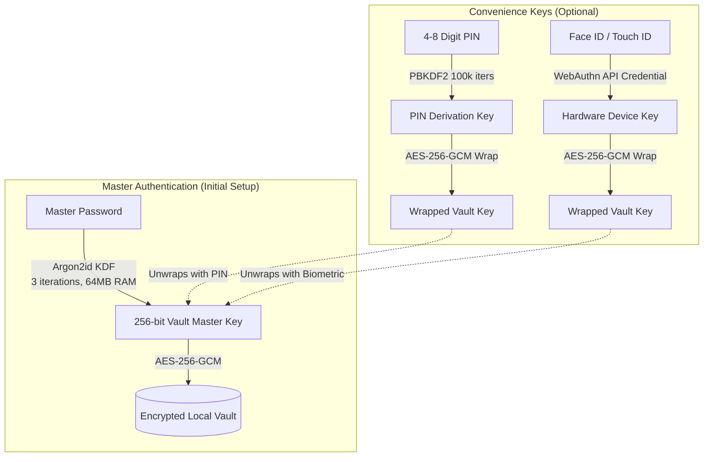

<div align="center">

# 🛡️ VEIL
### Zero-Knowledge, Offline-First Personal Password & Secrets Vault

[](https://www.typescriptlang.org/)
[](https://reactjs.org/)
[](https://tailwindcss.com/)
[](https://vitejs.dev/)
[](npm%20test)
[](https://abhiishek.is-a.dev/)
[](https://opensource.org/licenses/MIT)

<p align="center">
  A state-of-the-art, air-gapped personal password manager built for uncompromising privacy, security, and elegance.
  <br />
  <strong>No telemetry. No cloud accounts. No databases. Your data never leaves your device.</strong>
</p>

[Key Features](#-key-features) • [Security Architecture](#-security-architecture) • [Unlock Methods](#-unlock-methods) • [Quick Start](#-quick-start) • [Shortcuts](#-keyboard-shortcuts) • [PWA Guide](#-install-as-pwa)

---

</div>

## 🌟 Highlights

- **🔒 Military-Grade Cryptography**: Argon2id memory-hard key derivation + AES-256-GCM authenticated encryption.
- **👁️ Zero-Knowledge Architecture**: Master passwords and private keys are never stored on disk, memory is wiped, and keys stay strictly client-side.
- **🛡️ Multi-Vault Profile Isolation**: Scoped encrypted keys (`veil_vault_encrypted_data:[id]`) prevent multi-user collision and support separate personal, work, or custom vaults.
- **📳 Tactile Mobile Haptics**: Native-feeling haptic pulses on PIN entries, vault unlock, clipboard copy, lock, and security warnings.
- **📴 100% Offline-First (Air-Gapped)**: Completely functional without internet. All data lives in your browser's protected local storage.
- **⚡ Biometrics & Fast PIN**: Instant WebAuthn (Touch ID, Face ID, Android Fingerprint, Windows Hello) and PBKDF2 PIN unlock.
- **📱 Native PWA Feel**: Installable as a Progressive Web App on macOS, iOS, Windows, and Android with full touch gestures, safe area support, and tactile feedback.
- **🎨 Fluid Modern UI/UX**: Designed with smooth Framer Motion micro-animations, skeleton loaders, custom category icons, clipboard timeouts, and light/dark/system themes.

---

## 🔐 Security Architecture

Veil uses multi-tier cryptographic wrapping so you never have to choose between fortress-level security and mobile convenience.



### 🛡️ Defensive Safeguards
| Security Feature | Implementation | Purpose |
| :--- | :--- | :--- |
| **Master Key Derivation** | **Argon2id** (`hash-wasm`) | Thwarts GPU & ASIC brute-force attacks |
| **Data Encryption** | **AES-256-GCM** (Web Crypto API) | Authenticated encryption prevents tampering |
| **Quick PIN KDF** | **PBKDF2-SHA256** (100,000 rounds) | Mobile-optimized, rapid yet cryptographically sound |
| **Biometric Credentials** | **WebAuthn Public Key Credential** | Device-bound cryptographic hardware unlock |
| **Clipboard Scrubbing** | Configurable Auto-Clear Timer | Eliminates lingering passwords from device clipboard |
| **Inactivity Auto-Lock** | Active Activity Detection Hook | Locks vault immediately upon user inactivity |

---

## 🔑 Unlock Methods

Veil adapts to your operating workflow across all devices:

### 1. Master Password
The cryptographic root of your vault. Used for primary encryption, importing, and resetting auxiliary keys.

### 2. PIN Code
Tactile numeric pad with vibration/haptic feedback. Ideal for rapid smartphone checkouts or recurring desktop sessions.

### 3. Biometrics (Touch ID / Face ID / Windows Hello)
Seamless hardware-bound authentication via the W3C WebAuthn standard. Unlock in less than a second with a single finger touch or glance.

---

## 📁 Project Structure

```
veil/
├── public/                 # Static assets, PWA icons, manifest
├── src/
│   ├── components/         # Modular UI Components
│   │   ├── CreateVault.tsx        # Initial vault setup wizard
│   │   ├── EntryDetail.tsx        # Detail pane, password reveal & copy
│   │   ├── EntryForm.tsx          # Creation/edition of credentials
│   │   ├── EntryList.tsx          # Filterable, sortable credential list
│   │   ├── LockScreenRouter.tsx   # Dynamic unlock router (Password/PIN/Bio)
│   │   ├── PinPad.tsx             # Animated PIN keypad
│   │   ├── SearchModal.tsx        # Global search modal (⌘K)
│   │   ├── Settings.tsx           # Auto-lock, theme, export/import, PIN config
│   │   ├── Sidebar.tsx            # Navigation, tags, categories
│   │   ├── Skeleton.tsx           # Premium shimmer loading placeholders
│   │   └── Toast.tsx              # Toast notification alerts
│   ├── crypto/
│   │   └── engine.ts              # WebCrypto, Argon2id & WebAuthn primitives
│   ├── hooks/
│   │   └── useVault.ts            # Auto-lock timers, clipboard & keyboard shortcuts
│   ├── store/
│   │   └── vaultStore.ts          # Zustand state store with persistence
│   ├── types/
│   │   └── vault.ts               # Complete TypeScript data contracts
│   ├── App.tsx                    # Root layout orchestrator
│   └── main.tsx                   # Application entry point
├── index.html              # Shell template & PWA meta tags
├── package.json            # Project dependencies & scripts
├── tsconfig.json           # Strict TypeScript configuration
└── vite.config.js          # Fast Vite bundler config
```

---

## 🚀 Quick Start

### Prerequisites
- [Node.js](https://nodejs.org/) (v18 or higher recommended)
- [npm](https://www.npmjs.com/) or [pnpm](https://pnpm.io/)

### Installation

```bash
# Clone the repository
git clone https://github.com/codewithabhiishek/Veil.git

# Enter project directory
cd Veil

# Install dependencies
npm install

# Launch development server
npm run dev
```

Visit `http://localhost:3000` in your browser.

### Production Build

```bash
# Validate TypeScript typings
npm run typecheck

# Build optimized production bundle
npm run build
```

---

## ⌨️ Keyboard Shortcuts

Veil was designed with power users in mind:

| Shortcut | Action |
| :--- | :--- |
| <kbd>⌘</kbd> + <kbd>K</kbd> or <kbd>Ctrl</kbd> + <kbd>K</kbd> | Open Instant Global Search |
| <kbd>⌘</kbd> + <kbd>N</kbd> or <kbd>Ctrl</kbd> + <kbd>N</kbd> | Create New Vault Entry |
| <kbd>⌘</kbd> + <kbd>L</kbd> or <kbd>Ctrl</kbd> + <kbd>L</kbd> | Immediately Lock Vault |
| <kbd>Esc</kbd> | Dismiss active modal, drawer, or search |
| <kbd>↑</kbd> / <kbd>↓</kbd> | Navigate search list results |
| <kbd>Enter</kbd> | Select active item |

---

## 📱 Install as PWA

Veil is an installable PWA that functions like a native application without App Store downloads:

### iOS (Safari)
1. Navigate to your Veil instance in Safari.
2. Tap the **Share** button (box with an upward arrow).
3. Scroll down and tap **Add to Home Screen**.
4. Launch Veil from your home screen with edge-to-edge standalone display.

### Android (Chrome)
1. Open Veil in Chrome.
2. Tap the three-dot menu (**⋮**) in the upper right.
3. Tap **Install app** or **Add to Home screen**.

### macOS & Windows (Chrome / Edge / Safari)
1. In Chrome/Edge, click the **Install icon** in the right side of the address bar.
2. In macOS Safari (Sonoma+), choose **File → Add to Dock**.

---

## 🔒 Threat Model & Data Privacy

- **What Veil Encrypts at Rest**:
  - Passwords, usernames, custom text fields, private notes, TOTP secrets, recovery codes, and sensitive metadata.
- **What Remains Searchable Client-Side**:
  - Item labels, categories, and tags are maintained unencrypted locally so you can filter and search instantly without incurring decryption latency across hundreds of items.
- **No Remote Telemetry**:
  - Veil has zero external API endpoints, zero tracking pixels, and zero third-party telemetry scripts.

---

## 📜 License

Distributed under the **MIT License**. See [LICENSE](LICENSE) for more information.

<div align="center">
  <sub>Crafted with precision for privacy and security by <a href="https://abhiishek.is-a.dev/" target="_blank" rel="noopener noreferrer">Abhishek</a>.</sub>
</div>
